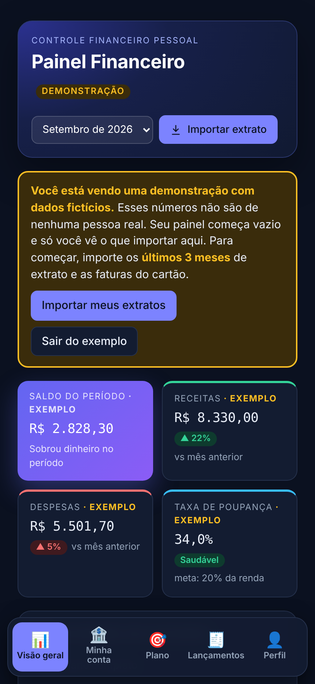
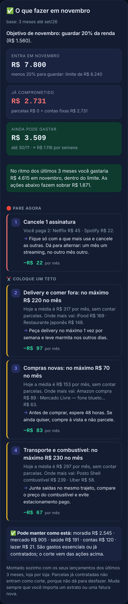

# Painel Financeiro com IA

Aplicativo web de finanças pessoais que lê extratos bancários, faturas de cartão e holerites em PDF e monta um plano de gastos para o mês: quanto ainda dá para gastar, o que cortar e quanto tempo leva para sair do vermelho.

**Demo:** [abrir o painel](https://claude.ai/artifact/Q7G5rJ5ckY2A62c6gf4DAN) → toque em **"Ver exemplo"** para navegar com dados fictícios.

> Projeto pessoal e acadêmico, desenvolvido com IA generativa (Claude, da Anthropic). Eu defini o problema, os requisitos e as regras de negócio, testei com meus próprios dados reais e conduzi as correções. A IA escreveu o código.

## O problema

Eu tinha dívidas espalhadas em vários lugares: cartão parcelado, cheque especial, a entrada de um apartamento e um acordo com um amigo. O app do banco mostra o extrato, mas não responde as perguntas que importam: **quanto ainda posso gastar este mês?** e **o que eu corto primeiro?**

## Funcionalidades

| Área | O que faz |
| --- | --- |
| Importação | Lê PDF de extrato, fatura e holerite, além de Excel e CSV, direto no navegador. Reconhece o tipo de documento, remove duplicadas e entende parcelas ("03/10") |
| Categorias | Classifica os gastos (alimentação, transporte, saúde, assinaturas…) e detecta contas fixas recorrentes |
| Plano do mês | Calcula quanto ainda dá para gastar depois da fatura, do aluguel e das parcelas, e sugere cortes com o valor economizado |
| Sair do vermelho | Simula quanto gastar por mês para zerar o negativo em 3, 6, 9 ou 12 meses, já com os juros do cheque especial |
| Dívidas | Soma cartão, cheque especial e acordos, compara com o limite e simula compras parceladas com juros |
| Cenários | Mostra lado a lado a situação atual e a situação após um empréstimo. A simulação nunca marca uma dívida como paga |
| Renda | Lê o holerite e usa a média dos últimos meses como renda real |
| Privacidade | Login, dados separados por usuário e painel vazio para quem abre o link sem estar logado |

## Tecnologias

- HTML, CSS e JavaScript puro (um único arquivo, sem framework)
- [pdf.js](https://mozilla.github.io/pdf.js/) para ler os PDFs e [Chart.js](https://www.chartjs.org/) para os gráficos
- Banco de dados por usuário com os dados separados por mês, mais uma rotina de auto-reparo que pode rodar várias vezes sem efeito colateral
- Testes automatizados com [Playwright](https://playwright.dev/), usando PDFs reais e dados simulados
- Desenvolvimento assistido por IA (Claude)

## Desafios e como resolvi

- **Fatura contada em dobro.** A mesma fatura foi importada duas vezes, e algumas compras ficaram no mês errado. Para resolver, defini uma regra: cada compra do cartão entra no mês em que a fatura vence. Também criei uma rotina que corrige as importações antigas automaticamente.
- **Categoria errada.** "Imposto" era classificado como "posto de gasolina", porque o texto contém "posto". Corrigi as regras de palavras e testei de novo com os extratos reais.
- **Simulação contando como dívida paga.** A regra passou a ser: dois cenários sempre separados, e nada é marcado como quitado enquanto o empréstimo for só uma simulação.
- **Privacidade.** Antes de compartilhar o link, mudei o painel para começar vazio e exigir login.

## O que aprendi

- Escrever requisitos claros e testáveis para uma IA
- Desconfiar da saída e validar com dados reais antes de dar como pronto
- Pensar em privacidade desde o começo
- Iterar em ciclos curtos: pedir, testar no celular, apontar o erro, corrigir

## Prints

Os prints usam apenas os dados fictícios do modo exemplo.

## Como rodar

O app foi feito para rodar publicado no Claude, que fornece o login e o banco de dados. Para ver o funcionamento, use o link da demo e toque em "Ver exemplo".

## Autor

**Raylson Lira**: [LinkedIn](https://linkedin.com/in/SEU-PERFIL)
